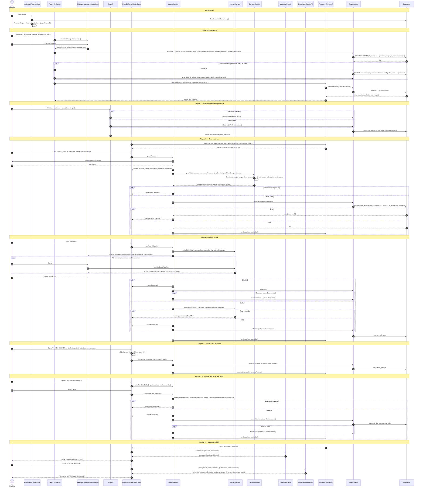

# Arquitetura do Projeto Timetable

App **Flutter** (web, Android, iOS, desktop) para montar horários escolares.
Usa **Riverpod** para estado, **Supabase** (Postgres + Realtime) como banco e
os pacotes **pdf / printing** para exportar a grade.

Fluxo geral em camadas:

```
Páginas (pages)  ──►  Helpers / Serviços  ──►  Providers (Riverpod)  ──►  Repositórios  ──►  Supabase
      ▲                                              │
      └──────────── streams realtime ◄───────────────┘
```

---

## 1. Diagrama de sequência

O diagrama abaixo cobre o uso completo do sistema: cadastro (Página 1),
indisponibilidade (Página 2) e montagem da grade (Página 3 — gerar, editar,
arrastar, validar e exportar PDF).



> Diagramas de sequência mais detalhados de partes isoladas (gerador,
> cadastro de curso) estão em [diagramas_sequencia.md](diagramas_sequencia.md).

---

## 2. Pastas do projeto

### Raiz

| Pasta / arquivo | O que faz |
|---|---|
| `lib/` | Todo o código Dart do app (detalhado abaixo). |
| `test/` | Testes automatizados (`flutter test`). |
| `test/apoio/` | Dados de exemplo (`dados.dart`) e um `RepositorioAula` falso em memória para testes sem Supabase. |
| `docs/` | Documentação (este arquivo e os diagramas de sequência). |
| `web/` | `index.html`, ícones e manifest do build web. |
| `android/`, `ios/`, `linux/`, `macos/`, `windows/` | Projetos nativos gerados pelo Flutter para cada plataforma (pouco ou nenhum código próprio). |
| `docker/` | `nginx.conf` usado pelo `Dockerfile` para servir o build web; manda `no-cache` para o `index.html` e o service worker (o navegador não fica com a versão antiga depois de um deploy). |
| `build/` | Saída de compilação (gerada, não versionada). |
| `Dockerfile` / `docker-compose.yml` | Compila o app web com o Flutter 3.47.7 (versão fixa) e serve com Nginx. |
| `vercel.json` | Configuração de deploy na Vercel (baixa o Flutter 3.47.7, `flutter build web`, reescreve rotas para `index.html`). |
| `firebase.json` | Configuração gerada pelo FlutterFire (projeto Firebase do Android/web); o app hoje usa o Supabase como banco. |
| `supabase_aulas_geminadas.sql` | 1º script do SQL Editor do Supabase: cria `tb_curso_aula_geminada` e colunas usadas pelo app (`periodo_preferencia`, `tamanho_bloco`, `grupo`). Também cria a coluna `turno_compartilhado` em `tb_curso`, que hoje não é mais usada. |
| `supabase_noite_tipos_horarios.sql` | 2º script: períodos 13–16 (noite), turma noturna, `tb_horario_periodo`, `tb_tipo_sala` (com "Quadra") e geminada com cargas diferentes (`quantidade_periodos_b`). |
| `supabase_turnos_transacoes.sql` | 3º script: os 5 turnos, exclusão em cascata de aulas ao excluir matéria/professor e as funções `substituir_aulas` e `salvar_carga_e_pares`. A última parte (`alter publication supabase_realtime ...`) liga o tempo real e só deve ser rodada depois de publicar o app novo. |
| `pubspec.yaml` | Dependências: `supabase_flutter`, `flutter_riverpod`, `pdf`, `printing`. |
| `analysis_options.yaml` | Regras de lint (`flutter_lints`). |

### Dentro de `lib/`

| Pasta | Responsabilidade |
|---|---|
| `lib/main.dart` | Ponto de entrada: inicializa o Supabase, cria o `ProviderScope` e o `MaterialApp` com as 3 rotas. |
| `lib/model/` | Classes de dados (entidades do banco) com `fromJson` / `toInsertJson`. Sem lógica de tela. |
| `lib/services/` | Regras de negócio puras: geração, validação, exportação PDF e arrumação dos grupos depois de exclusões. |
| `lib/services/repositories/` | Acesso ao Supabase (CRUD + streams realtime), um repositório por entidade, mais o helper comum `observar_tabela.dart`. |
| `lib/providers/` | Providers Riverpod que expõem os repositórios e as listas em tempo real. |
| `lib/pages/` | Telas do app (Página 1, 2, 3) e o layout comum. |
| `lib/pages/page1/columns/` | As 4 colunas de cadastro da Página 1. |
| `lib/pages/page3/helpers/` | Lógica da Página 3 separada dos widgets (ações, regras de edição/arraste e formato do horário dos períodos). |
| `lib/pages/page3/widgets/` | Widgets específicos da Página 3 (barra de ações, grade do curso, células, campo de horário, lista lateral, painel de validação). |
| `lib/components/` | Widgets reutilizáveis entre páginas (cartão, coluna, grade horária). |
| `lib/components/dialogs/` | Diálogos de formulário e confirmação. |
| `lib/theme/` | Cores e tema visual (identidade IFPR). |

---

## 3. Classes por pasta

### `lib/model/` — Modelos de dados

| Classe / arquivo | O que representa |
|---|---|
| `Aula` (`aula/aula.dart`) | Uma aula alocada: curso, dia (0–4), período (0–15: 0–5 manhã, 6–11 tarde, 12–15 noite), matéria, professor, sala opcional e `grupo` (1 ou 2, quando a turma é dividida). Converte índices 0‑based ↔ colunas 1‑based do banco (`tb_aula`, `periodo` 1–16). |
| `Curso` (`curso/curso.dart`) | Turma: nome, sala padrão e `preferenciaPeriodo` (turno). A coluna `turno_compartilhado` ainda existe no banco, mas o app não usa mais. |
| `PreferenciaPeriodo` (`curso/preferencia_periodo.dart`) | Enum do "Turno" do curso: `manha`, `tarde`, `noite`, `manhaTarde` ("Manhã CT: Tarde") e `tardeManha` ("Tarde CT: Manhã"). `turnos` diz quais turnos o gerador usa e em que ordem; `maxAulasPorBloco` dá o maior bloco (6 de manhã/tarde, 4 à noite). A edição manual não é limitada pelo turno. |
| `CargaCursoMateria` (`curso/carga_curso_materia.dart`) | Quantas aulas por semana uma matéria tem num curso e o `tamanhoBloco` (aulas seguidas, até 6 de manhã/tarde ou 4 à noite). |
| `AulaGeminadaCurso` (`curso/aula_geminada_curso.dart`) | Par de matérias que acontecem no mesmo horário, cada uma com a sua quantidade (`quantidadeA`, `quantidadeB`) e em quantos blocos dividir. O par ocupa `periodosOcupados` = max(A, B) horários: `juntas` = min(A, B) com os dois grupos e o resto só com a matéria maior (`idMateriaMaior`) no grupo 2, com G1 livre. Também tem as funções `existeAulaGeminada`, `materiasGeminadasCom` e `dividirEmBlocos`. |
| `HorarioPeriodo` (`horario/horario_periodo.dart`) | Texto do horário de um período ("HH:MM - HH:MM"), global para todas as turmas (`tb_horario_periodo`). |
| `Materia` (`materia/materia.dart`) | Disciplina (id + nome). |
| `Professor` (`professor/professor.dart`) | Professor (id + nome). |
| `ProfessorMateria` (`professor/professor_materia.dart`) | Ligação N:N indicando quais matérias cada professor pode dar. |
| `IndisponibilidadeProfessor` (`professor/indisponibilidade_professor.dart`) | Um horário (dia/período) em que o professor não pode dar aula. |
| `Sala`, `TipoSala`, `SalaDuplicada`, `TipoSalaDuplicado` (`sala/sala.dart`) | Sala com número e tipo. `TipoSala` é uma classe (id + nome) com os tipos cadastrados pelo usuário em `tb_tipo_sala` (ex.: Sala de aula, Laboratório de informática, Quadra). `SalaDuplicada` é a exceção lançada ao cadastrar número/tipo repetido; `TipoSalaDuplicado`, ao repetir o nome de um tipo. |

### `lib/services/repositories/` — Acesso ao Supabase

Todos seguem o mesmo padrão: `observarTodos()` usa o helper comum
`observarTabela` (`observar_tabela.dart`), que devolve um `Stream` com um
`SELECT` inicial e reemite a lista quando o canal realtime do Supabase avisa
de uma mudança na tabela. Vários avisos seguidos viram uma busca só, depois
de 300 ms sem novos avisos, e uma resposta mais antiga que chegue depois de
uma mais nova é descartada. O realtime só funciona depois de rodar a parte
`alter publication supabase_realtime ...` de `supabase_turnos_transacoes.sql`;
até lá as telas atualizam pelo `ref.invalidate` feito depois de cada ação.
As listas de professores, matérias, salas, tipos de sala e cursos vêm em
ordem de criação (id crescente). Os repositórios não invalidam providers:
quem faz isso são as colunas da Página 1, a Página 2 e o `AcoesHorario`.

Excluir matéria, professor, curso ou sala é um único `DELETE`; o banco
apaga em cascata o que depende deles (em `tb_aula`, as aulas da
matéria/professor/curso são apagadas e a sala vira `null`).

| Classe | O que faz |
|---|---|
| `RepositorioSala` | CRUD de salas (com o tipo junto); converte o erro de chave única do banco (`23505`) em `SalaDuplicada`. |
| `RepositorioTipoSala` | Lista e cria tipos de sala (`tb_tipo_sala`); nome repetido vira `TipoSalaDuplicado`. |
| `RepositorioMateria` | CRUD de matérias e definição de quais professores lecionam cada uma (`definirProfessores`). |
| `RepositorioProfessor` | CRUD de professores, stream das ligações professor‑matéria (`observarLigacoesMaterias`) e `definirMaterias`. |
| `RepositorioCurso` | CRUD de cursos, com streams separados para cursos, cargas e aulas geminadas. `salvarCargaEPares` chama a função `salvar_carga_e_pares(p_id_curso, p_cargas, p_pares)` do banco, que troca carga e pares e apaga as aulas de matérias que saíram da carga numa transação só. |
| `RepositorioIndisponibilidade` | Marca/desmarca horários indisponíveis de professores. |
| `RepositorioHorarioPeriodo` | Lê e grava (upsert) o texto do horário de cada período em `tb_horario_periodo`. |
| `RepositorioAula` | `tb_aula`: `observarTodos`, `buscarTodos`, `adicionar`, `atualizar`, `excluir`, `excluirPorCurso`, `substituirTodas` (chama `substituir_aulas(novas)`: o "Gerar" troca a grade inteira numa transação; se falhar, nada muda), `moverAulas` (arraste) e `ordemParaMover` (ordem em que as aulas são gravadas para não violar a chave única). |

### `lib/services/` — Regras de negócio

| Classe | O que faz |
|---|---|
| `GeradorHorario` | Algoritmo de geração automática. `gerarTodos` ordena cursos pela maior carga e chama `gerar` para cada um, acumulando as aulas já colocadas para evitar choques entre turmas. Em cada curso aloca primeiro as aulas geminadas e depois as matérias em blocos, usando só os turnos do curso (na ordem do turno), com bloco limitado pelo turno (6 de manhã/tarde, 4 à noite), professor livre/disponível e uma aula por matéria por dia. |
| `ResultadoGeracao` / `ResultadoGeracaoCompleta` | Retorno do gerador: aulas novas, falhas (mensagens) e se ficou `completo`. |
| `ValidadorHorario` | Verifica a grade de uma turma e retorna problemas para o painel de avisos: carga cumprida, choque de professor/sala, indisponibilidade, mais de 2 grupos, "Par não geminado", professor não vinculado à matéria, grupo 2 sozinho sem par, geminada configurada acima da carga e as contagens de cada geminada (horários juntos e só da matéria maior, contados por matéria quando dois pares dividem a mesma matéria maior). Não avisa aula fora do turno da turma. |
| `ValidacaoHorario` | Resultado do validador (`problemas`, `ok`). |
| `ExportadorHorarioPdf` | Gera um PDF A4 em paisagem com uma página por turma, juntando horários seguidos iguais num só bloco. Imprime os turnos do curso e também qualquer turno em que a turma tenha aula, o horário de cada período, e calcula a altura das linhas para tudo caber na página. |
| `arrumacao_grupos.dart` (`aulasQueViramCompletas`, `aulasQueVaoParaGrupo2`, `arrumarGruposSemPar`) | Mantém os grupos coerentes depois de excluir matéria ou professor ou de tirar um par de um curso: aula sozinha no grupo 2 sem par vira aula completa (grupo 1); se o professor excluído dava o grupo 2 de um par que ainda existe, o grupo 1 que sobra passa para o grupo 2. Duas aulas juntas que não formam mais par ficam como estão (o validador avisa "Par não geminado"). |
| `SegmentoGrade` / `agruparAulasSeguidas` | Estrutura auxiliar do PDF: trecho de horários consecutivos com as mesmas aulas. |

### `lib/providers/` — Riverpod

| Arquivo | O que faz |
|---|---|
| `repository_providers.dart` | Um `Provider` por repositório (`provedorRepositorioSala`, `…Aula`, etc.), para injetar dependência e permitir trocar por versões falsas nos testes. |
| `stream_providers.dart` | `StreamProvider`s com as listas em tempo real (`provedorSalas`, `provedorTiposSala`, `provedorCursos`, `provedorAulas`, `provedorHorariosPeriodo`, `provedorIndisponibilidades` …). As telas usam `ref.watch` neles. |
| `providers.dart` | Apenas reexporta os dois arquivos acima. |

### `lib/pages/` — Telas

| Classe | O que faz |
|---|---|
| `LayoutBase` (`layout_base.dart`) | Scaffold comum com AppBar e botões de navegação entre as páginas (`_NavButton`). |
| `Page1` (`page1/page1.dart`) | Tela de cadastros: mostra lado a lado as colunas de professores, matérias, salas e cursos. |
| `ColunaProfessor` | Lista professores; abre o diálogo de professor e grava nome + matérias. Ao excluir, calcula antes quais aulas de grupo 1 passam para o grupo 2 (`aulasQueVaoParaGrupo2`), exclui o professor (cascata no banco) e grava essas aulas. |
| `ColunaMateria` | Lista matérias; abre o diálogo de matéria e grava nome + professores. Ao excluir, chama `arrumarGruposSemPar`. |
| `ColunaSala` | Lista salas; abre o diálogo de número/tipo, onde também dá para criar um tipo novo. Ao excluir, invalida cursos e aulas que usavam a sala. |
| `ColunaCurso` | Lista cursos; abre o diálogo completo de curso (turno, cargas, blocos, geminadas) e grava tudo no `RepositorioCurso`. Ao editar, chama `arrumarGruposSemPar` (par tirado do curso). |
| `Page2` (`page2/page2.dart`) | Seleciona um professor e alterna células da grade para marcar/desmarcar indisponibilidade. |
| `Page3` (`page3/page3.dart`) | Tela principal de horários: observa todos os providers, mostra a barra do topo (Gerar e PDF), controla o curso selecionado e o estado "ocupado", e repassa as ações (gerar, limpar, PDF, tocar, soltar, salvar horário do período) para `AcoesHorario`. |

#### `lib/pages/page3/helpers/`

| Classe / arquivo | O que faz |
|---|---|
| `AcoesHorario` (`acoes_horario.dart`) | Ações da Página 3 sem layout. Usa o container do `ProviderScope` (continua válido mesmo se a tela sair da árvore no meio de uma gravação) e só trava a grade depois dos diálogos de confirmação. `gerarTodos` (gera primeiro e grava com `substituirTodas`; se falhar, a grade anterior fica), `limparCurso`, `aoTocarCelula` (decide editar ou adicionar 2º grupo, abre o formulário que valida antes de fechar, e grava; ao excluir um grupo de um par, o que sobra vai para o grupo 2), `moverAula` e `motivoParaNaoSoltar` (drag and drop, move o conjunto geminado inteiro) e `salvarHorarioPeriodo`. |
| `regras_horario.dart` | Funções puras de regra: `aulasNaCelula`, `proximoGrupoLivre`, `materiasDoCurso`, `professoresParaDialogoAula`, `quantidadeAgendada`, `cargaMaxima`, `subtituloProgresso`, `validarSalvarAula`, `aulasQueMovemJunto`, `deslocarAulas` e `validarMoverAulas` (`maxGruposPorCelula` = 2). Usadas pela tela, pelo validador e pelos testes. |
| `formato_horario.dart` | Máscara do horário do período (`MascaraHorarioFormatter`, só números, molde "00:00 - 00:00") e `validarHorario` (hora ≤ 23, minuto ≤ 59; vazio apaga o horário). |

#### `lib/pages/page3/widgets/`

| Classe | O que faz |
|---|---|
| `BarraAcoesHorario` | Barra no topo da Página 3 com os botões "Gerar" e "PDF" em destaque, sempre visíveis. |
| `PainelGradeCurso` | Painel do curso selecionado: cabeçalho com botões (Limpar, Fechar), a `GradeHoraria` com `CelulaHorario`, os rótulos de período com `CampoHorarioPeriodo` e o painel de validação (chama `ValidadorHorario`). |
| `CelulaHorario` | Uma célula da grade: mostra as aulas (matéria, professor, sala, grupo, ou "G1 livre"), é `Draggable` e `DragTarget` e pinta de vermelho/verde se pode soltar. |
| `CampoHorarioPeriodo` | Campo na coluna de rótulos para editar o horário do período ("HH:MM - HH:MM"); só salva texto válido. |
| `ListaCursosHorario` | Lista lateral de cursos com o progresso de aulas agendadas; selecionar um abre a grade. |
| `PainelValidacaoHorario` | Faixa abaixo da grade que lista os problemas encontrados ou "sem problemas". |

### `lib/components/` — Widgets reutilizáveis

| Classe | O que faz |
|---|---|
| `CartaoItem` | Cartão de lista com título, subtítulo e botões editar/excluir. |
| `ColunaQuadro` | Coluna com título, ícone, botões de ação no cabeçalho e conteúdo (usada nas Páginas 1, 2 e 3). |
| `DicaColunaVazia` | Mensagem exibida quando uma coluna/área está vazia. |
| `GradeHoraria` | Grade genérica Seg–Sex × 16 períodos: 6 de manhã (0–5), separador "Almoço", 6 de tarde (6–11), separador "Jantar" e 4 à noite (12–15). Recebe um construtor de célula e, opcionalmente, de rótulo de período. Tem os rótulos de dias/períodos e utilitários de turno (`periodosManha`, `periodosTarde`, `periodosNoite`, `faixaDoPeriodo`). |
| `CelulaGrade` | Coordenada de uma célula (índice do dia + índice do período). |

#### `lib/components/dialogs/`

| Arquivo / classe | O que faz |
|---|---|
| `dialogo_confirmar_exclusao.dart` | `mostrarDialogoConfirmarExclusao`: diálogo genérico de confirmação (sim/não). |
| `dialogo_numero.dart` (`DadosSala`) | Formulário de sala: número e tipo (escolhe um tipo existente ou cria um novo). |
| `dialogo_formulario_materia.dart` (`ResultadoFormularioMateria`) | Formulário de matéria: nome e professores. |
| `dialogo_formulario_professor.dart` (`ResultadoFormularioProfessor`) | Formulário de professor: nome e matérias. |
| `dialogo_formulario_curso.dart` (`ResultadoFormularioCurso`) | Formulário completo de curso: nome, sala, turno (5 opções), linhas de carga (matéria, quantidade, tamanho do bloco limitado pelo turno) e linhas de aulas geminadas (Matéria A, Matéria B, Aulas de A, Aulas de B, Blocos). |
| `dialogo_formulario_aula.dart` (`ResultadoFormularioAula`, `ExclusaoFormularioAula`) | Formulário de uma aula na Página 3: matéria, professor (filtrado por quem está livre) e sala; valida antes de fechar (se a regra recusar, continua aberto mostrando o motivo); pode retornar salvar ou excluir. |

### `lib/theme/`

| Classe | O que faz |
|---|---|
| `IfprColors` + `buildIfprTheme()` | Paleta verde do IFPR e o `ThemeData` aplicado no `MaterialApp`. |

### `test/` — Testes

| Arquivo | O que testa |
|---|---|
| `modelos_test.dart` | Conversão JSON dos modelos. |
| `gerador_test.dart` / `gerador_geminada_test.dart` | Algoritmo de geração, incluindo aulas geminadas. |
| `validador_test.dart` | Regras do `ValidadorHorario`. |
| `edicao_pagina3_regras_test.dart` / `edicao_pagina3_tela_test.dart` | Regras e tela de edição de células na Página 3. |
| `mover_aulas_regras_test.dart` | Regras do arrastar/soltar. |
| `exportador_pdf_test.dart` | Agrupamento e geração do PDF. |
| `formulario_curso_geminada_test.dart` / `formulario_materia_test.dart` | Diálogos de formulário. |
| `geminada_cargas_diferentes_test.dart` | Geminada com cargas diferentes (A ≠ B): gerador, validador, G1 livre, exclusão de grupos e arraste do conjunto inteiro. |
| `noite_horarios_salas_test.dart` | Grade de 16 períodos e turma noturna, turnos impressos no PDF, horários dos períodos na Página 3 e tipos de sala. |
| `formato_horario_test.dart` | Máscara "00:00 - 00:00" e validação do horário do período. |
