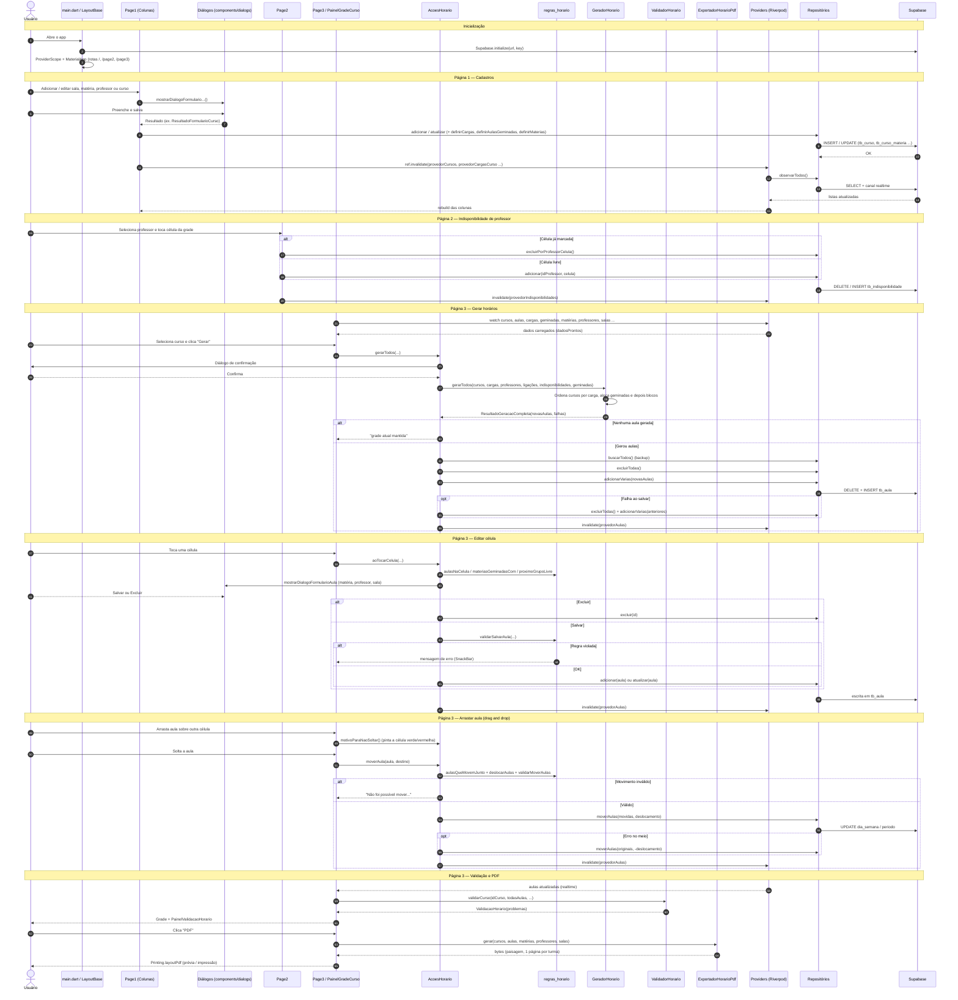

# Arquitetura do Projeto Timetable

App **Flutter** (web, Android, iOS, desktop) para montar horários escolares.
Usa **Riverpod** para estado, **Supabase** (Postgres + Realtime) como banco e
os pacotes **pdf / printing** para exportar a grade.

Fluxo geral em camadas:

```
Páginas (pages)  ──►  Helpers / Serviços  ──►  Providers (Riverpod)  ──►  Repositórios  ──►  Supabase
      ▲                                              │
      └──────────── streams realtime ◄───────────────┘
```

---

## 1. Diagrama de sequência

O diagrama abaixo cobre o uso completo do sistema: cadastro (Página 1),
indisponibilidade (Página 2) e montagem da grade (Página 3 — gerar, editar,
arrastar, validar e exportar PDF).



> Diagramas de sequência mais detalhados de partes isoladas (gerador,
> cadastro de curso) estão em [diagramas_sequencia.md](diagramas_sequencia.md).

---

## 2. Pastas do projeto

### Raiz

| Pasta / arquivo | O que faz |
|---|---|
| `lib/` | Todo o código Dart do app (detalhado abaixo). |
| `test/` | Testes automatizados (`flutter test`). |
| `test/apoio/` | Dados de exemplo (`dados.dart`) e um `RepositorioAula` falso em memória para testes sem Supabase. |
| `docs/` | Documentação (este arquivo e os diagramas de sequência). |
| `web/` | `index.html`, ícones e manifest do build web. |
| `android/`, `ios/`, `linux/`, `macos/`, `windows/` | Projetos nativos gerados pelo Flutter para cada plataforma (pouco ou nenhum código próprio). |
| `docker/` | `nginx.conf` usado pelo `Dockerfile` para servir o build web. |
| `build/` | Saída de compilação (gerada, não versionada). |
| `Dockerfile` / `docker-compose.yml` | Compila o app web com Flutter e serve com Nginx. |
| `vercel.json` | Configuração de deploy na Vercel (baixa Flutter, `flutter build web`, reescreve rotas para `index.html`). |
| `firebase.json` | Configuração gerada pelo FlutterFire (projeto Firebase do Android/web); o app hoje usa o Supabase como banco. |
| `supabase_aulas_geminadas.sql` | Script para rodar uma vez no SQL Editor do Supabase: cria `tb_curso_aula_geminada` e a coluna `turno_compartilhado` em `tb_curso`. |
| `pubspec.yaml` | Dependências: `supabase_flutter`, `flutter_riverpod`, `pdf`, `printing`. |
| `analysis_options.yaml` | Regras de lint (`flutter_lints`). |

### Dentro de `lib/`

| Pasta | Responsabilidade |
|---|---|
| `lib/main.dart` | Ponto de entrada: inicializa o Supabase, cria o `ProviderScope` e o `MaterialApp` com as 3 rotas. |
| `lib/model/` | Classes de dados (entidades do banco) com `fromJson` / `toInsertJson`. Sem lógica de tela. |
| `lib/services/` | Regras de negócio puras: geração, validação e exportação PDF. |
| `lib/services/repositories/` | Acesso ao Supabase (CRUD + streams realtime), um repositório por entidade. |
| `lib/providers/` | Providers Riverpod que expõem os repositórios e as listas em tempo real. |
| `lib/pages/` | Telas do app (Página 1, 2, 3) e o layout comum. |
| `lib/pages/page1/columns/` | As 4 colunas de cadastro da Página 1. |
| `lib/pages/page3/helpers/` | Lógica da Página 3 separada dos widgets (ações e regras de edição/arraste). |
| `lib/pages/page3/widgets/` | Widgets específicos da Página 3 (grade do curso, células, lista lateral, painel de validação). |
| `lib/components/` | Widgets reutilizáveis entre páginas (cartão, coluna, grade horária). |
| `lib/components/dialogs/` | Diálogos de formulário e confirmação. |
| `lib/theme/` | Cores e tema visual (identidade IFPR). |

---

## 3. Classes por pasta

### `lib/model/` — Modelos de dados

| Classe / arquivo | O que representa |
|---|---|
| `Aula` (`aula/aula.dart`) | Uma aula alocada: curso, dia (0–4), período (0–11), matéria, professor, sala opcional e `grupo` (1 ou 2, quando a turma é dividida). Converte índices 0‑based ↔ colunas 1‑based do banco (`tb_aula`). |
| `Curso` (`curso/curso.dart`) | Turma: nome, sala padrão, `preferenciaPeriodo` e `turnoCompartilhado` (permite 2 grupos no mesmo horário). |
| `PreferenciaPeriodo` (`curso/preferencia_periodo.dart`) | Enum `manhaTarde` / `tardeManha`: em qual turno o gerador começa a encaixar aulas. |
| `CargaCursoMateria` (`curso/carga_curso_materia.dart`) | Quantas aulas por semana uma matéria tem num curso e o `tamanhoBloco` (aulas seguidas, até 6). |
| `AulaGeminadaCurso` (`curso/aula_geminada_curso.dart`) | Par de matérias que acontecem no mesmo horário (G1 numa, G2 na outra), com total de períodos e em quantos blocos dividir. Também tem as funções `existeAulaGeminada`, `materiasGeminadasCom` e `dividirEmBlocos`. |
| `Materia` (`materia/materia.dart`) | Disciplina (id + nome). |
| `Professor` (`professor/professor.dart`) | Professor (id + nome). |
| `ProfessorMateria` (`professor/professor_materia.dart`) | Ligação N:N indicando quais matérias cada professor pode dar. |
| `IndisponibilidadeProfessor` (`professor/indisponibilidade_professor.dart`) | Um horário (dia/período) em que o professor não pode dar aula. |
| `Sala`, `TipoSala`, `SalaDuplicada` (`sala/sala.dart`) | Sala com número e tipo (sala de aula ou laboratório de informática); `SalaDuplicada` é a exceção lançada ao cadastrar número/tipo repetido. |

### `lib/services/repositories/` — Acesso ao Supabase

Todos seguem o mesmo padrão: `observarTodos()` devolve um `Stream` que faz
`SELECT` inicial e reemite a lista sempre que o canal realtime do Supabase
avisa de uma mudança na tabela; além disso têm `buscar…`, `adicionar`,
`atualizar` e `excluir`.

| Classe | O que faz |
|---|---|
| `RepositorioSala` | CRUD de salas; converte o erro de chave única do banco (`23505`) em `SalaDuplicada`. |
| `RepositorioMateria` | CRUD de matérias e definição de quais professores lecionam cada uma (`definirProfessores`). |
| `RepositorioProfessor` | CRUD de professores, stream das ligações professor‑matéria (`observarLigacoesMaterias`) e `definirMaterias`. |
| `RepositorioCurso` | CRUD de cursos + cargas (`definirCargas`) + aulas geminadas (`definirAulasGeminadas`), com streams separados para cada um. |
| `RepositorioIndisponibilidade` | Marca/desmarca horários indisponíveis de professores. |
| `RepositorioAula` | CRUD de `tb_aula`; `adicionarVarias` (gravação em lote do gerador), `moverAulas` (arraste, atualizando na ordem certa para não violar a chave única), exclusões por curso/professor/matéria e `excluirTodas`. |

### `lib/services/` — Regras de negócio

| Classe | O que faz |
|---|---|
| `GeradorHorario` | Algoritmo de geração automática. `gerarTodos` ordena cursos pela maior carga e chama `gerar` para cada um, acumulando as aulas já colocadas para evitar choques entre turmas. Em cada curso aloca primeiro as aulas geminadas e depois as matérias em blocos, respeitando turno preferido, professor livre/disponível e uma aula por matéria por dia. |
| `ResultadoGeracao` / `ResultadoGeracaoCompleta` | Retorno do gerador: aulas novas, falhas (mensagens) e se ficou `completo`. |
| `ValidadorHorario` | Verifica a grade de uma turma (carga cumprida, turno, choque de professor/sala, indisponibilidade, geminadas) e retorna problemas para o painel de avisos. |
| `ValidacaoHorario` | Resultado do validador (`problemas`, `ok`). |
| `ExportadorHorarioPdf` | Gera um PDF em paisagem com uma página por turma, juntando horários seguidos iguais num só bloco. |
| `SegmentoGrade` / `agruparAulasSeguidas` | Estrutura auxiliar do PDF: trecho de horários consecutivos com as mesmas aulas. |

### `lib/providers/` — Riverpod

| Arquivo | O que faz |
|---|---|
| `repository_providers.dart` | Um `Provider` por repositório (`provedorRepositorioSala`, `…Aula`, etc.), para injetar dependência e permitir trocar por versões falsas nos testes. |
| `stream_providers.dart` | `StreamProvider`s com as listas em tempo real (`provedorSalas`, `provedorCursos`, `provedorAulas`, `provedorIndisponibilidades` …). As telas usam `ref.watch` neles. |
| `providers.dart` | Apenas reexporta os dois arquivos acima. |

### `lib/pages/` — Telas

| Classe | O que faz |
|---|---|
| `LayoutBase` (`layout_base.dart`) | Scaffold comum com AppBar e botões de navegação entre as páginas (`_NavButton`). |
| `Page1` (`page1/page1.dart`) | Tela de cadastros: mostra lado a lado as colunas de professores, matérias, salas e cursos. |
| `ColunaProfessor` | Lista professores; abre o diálogo de professor e grava nome + matérias. |
| `ColunaMateria` | Lista matérias; abre o diálogo de matéria e grava nome + professores. |
| `ColunaSala` | Lista salas; abre o diálogo de número/tipo. Ao excluir, invalida cursos e aulas que usavam a sala. |
| `ColunaCurso` | Lista cursos; abre o diálogo completo de curso (cargas, blocos, geminadas) e grava tudo no `RepositorioCurso`. |
| `Page2` (`page2/page2.dart`) | Seleciona um professor e alterna células da grade para marcar/desmarcar indisponibilidade. |
| `Page3` (`page3/page3.dart`) | Tela principal de horários: observa todos os providers, controla o curso selecionado e o estado "ocupado", e repassa as ações (gerar, limpar, PDF, tocar, soltar) para `AcoesHorario`. |

#### `lib/pages/page3/helpers/`

| Classe / arquivo | O que faz |
|---|---|
| `AcoesHorario` (`acoes_horario.dart`) | Ações da Página 3 sem layout: `gerarTodos` (com backup e restauração da grade anterior), `limparCurso`, `aoTocarCelula` (decide editar ou adicionar 2º grupo, abre o formulário, valida e grava), `moverAula` e `motivoParaNaoSoltar` (drag and drop). |
| `regras_horario.dart` | Funções puras de regra: `aulasNaCelula`, `proximoGrupoLivre`, `materiasDoCurso`, `professoresParaDialogoAula`, `quantidadeAgendada`, `cargaMaxima`, `subtituloProgresso`, `validarSalvarAula`, `aulasQueMovemJunto`, `deslocarAulas` e `validarMoverAulas`. Usadas pela tela, pelo validador e pelos testes. |

#### `lib/pages/page3/widgets/`

| Classe | O que faz |
|---|---|
| `PainelGradeCurso` | Painel do curso selecionado: cabeçalho com botões (Gerar, PDF, Limpar, Fechar), a `GradeHoraria` com `CelulaHorario` e o painel de validação (chama `ValidadorHorario`). |
| `CelulaHorario` | Uma célula da grade: mostra as aulas (matéria, professor, sala, grupo), é `Draggable` e `DragTarget` e pinta de vermelho/verde se pode soltar. |
| `ListaCursosHorario` | Lista lateral de cursos com o progresso de aulas agendadas; selecionar um abre a grade. |
| `PainelValidacaoHorario` | Faixa abaixo da grade que lista os problemas encontrados ou "sem problemas". |

### `lib/components/` — Widgets reutilizáveis

| Classe | O que faz |
|---|---|
| `CartaoItem` | Cartão de lista com título, subtítulo e botões editar/excluir. |
| `ColunaQuadro` | Coluna com título, ícone, botões de ação no cabeçalho e conteúdo (usada nas Páginas 1, 2 e 3). |
| `DicaColunaVazia` | Mensagem exibida quando uma coluna/área está vazia. |
| `GradeHoraria` | Grade genérica Seg–Sex × 12 períodos (manhã e tarde); recebe um construtor de célula. Tem os rótulos de dias/períodos e utilitários de faixa (`faixaDoPeriodo`). |
| `CelulaGrade` | Coordenada de uma célula (índice do dia + índice do período). |
| `GradeHorariaVazia` | Placeholder de grade sem dados. |

#### `lib/components/dialogs/`

| Arquivo / classe | O que faz |
|---|---|
| `dialogo_confirmar_exclusao.dart` | `mostrarDialogoConfirmarExclusao`: diálogo genérico de confirmação (sim/não). |
| `dialogo_numero.dart` (`DadosSala`) | Formulário de sala: número e tipo. |
| `dialogo_formulario_materia.dart` (`ResultadoFormularioMateria`) | Formulário de matéria: nome e professores. |
| `dialogo_formulario_professor.dart` (`ResultadoFormularioProfessor`) | Formulário de professor: nome e matérias. |
| `dialogo_formulario_curso.dart` (`ResultadoFormularioCurso`) | Formulário completo de curso: nome, sala, turno preferido, turno compartilhado, linhas de carga (matéria, quantidade, tamanho do bloco) e linhas de aulas geminadas. |
| `dialogo_formulario_aula.dart` (`ResultadoFormularioAula`, `ExclusaoFormularioAula`) | Formulário de uma aula na Página 3: matéria, professor (filtrado por quem está livre) e sala; pode retornar salvar ou excluir. |

### `lib/theme/`

| Classe | O que faz |
|---|---|
| `IfprColors` + `buildIfprTheme()` | Paleta verde do IFPR e o `ThemeData` aplicado no `MaterialApp`. |

### `test/` — Testes

| Arquivo | O que testa |
|---|---|
| `modelos_test.dart` | Conversão JSON dos modelos. |
| `gerador_test.dart` / `gerador_geminada_test.dart` | Algoritmo de geração, incluindo aulas geminadas. |
| `validador_test.dart` | Regras do `ValidadorHorario`. |
| `edicao_pagina3_regras_test.dart` / `edicao_pagina3_tela_test.dart` | Regras e tela de edição de células na Página 3. |
| `mover_aulas_regras_test.dart` | Regras do arrastar/soltar. |
| `exportador_pdf_test.dart` | Agrupamento e geração do PDF. |
| `formulario_curso_geminada_test.dart` / `formulario_materia_test.dart` | Diálogos de formulário. |
